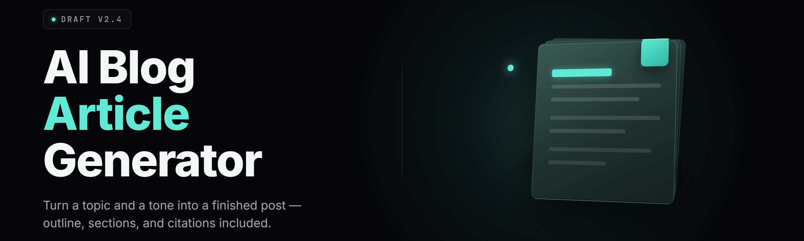

  
  
  

  

  
  
  

---

**Write a publish-ready 1,800-word post in the time it takes to brew coffee. Research, outline, draft, SEO, images — one .exe, offline-first, no subscription.**

*Version 2.4.1 — see FAQ for detection/updates*

---

## 📝 Overview

**AI Blog Article Generator** is a Windows desktop tool that turns a single seed keyword into a full, publishable blog article — title, meta description, headings, body, internal links, schema markup, and featured image prompt. It runs locally against any OpenAI-compatible endpoint or bundled offline model, so your drafts never leave your machine unless you tell them to.

| Category | Details |
|---|---|
| **What it is** | Offline-first desktop article engine for WordPress, Ghost, Substack, and static blogs |
| **Core flow** | Keyword → SERP research → outline → draft → SEO pass → export |
| **Models** | Bundled 8B local model + OpenAI / Anthropic / Groq / Ollama / LM Studio endpoints |
| **Output** | Markdown, HTML, WordPress XML-RPC, Ghost Admin API, plain text |
| **Runtime** | Native Windows `.exe`, no Python, no Node, no install wizard |
| **Storage** | SQLite project vault, portable, lives next to the `.exe` |
| **Batch** | Queue 200 keywords, walk away, come back to 200 drafts |

Every serious content operation hits the same wall: writing scales linearly with human hours, and human hours are the one thing you can't buy back. This tool breaks that wall without turning your blog into obvious AI slop — the SEO pass, the humanization pass, and the brand-voice memory are what separate a draft you'd actually publish from a draft you'd delete.

---

## ❓ FAQ

<b>Will Google penalize articles generated with this tool?</b>

Google penalizes low-quality content, not tooling. The generator ships a humanization pass, a burstiness/variance tuner, and a fact-hedge filter specifically to avoid the repetitive cadence that gets flagged. You still review before you publish — that's the workflow, not a workaround.

<b>Does it need an internet connection?</b>

No. The bundled 8B local model runs entirely on your machine. Online endpoints (OpenAI, Anthropic, Groq) are optional and only used if you configure an API key. SERP research is the one feature that wants a connection; it degrades gracefully to a local heuristic when offline.

<b>How do updates work?</b>

The `.exe` checks a manifest on launch and shows a one-line update notice. Download the new build, extract over the old folder, keep your `vault.db` — projects, brand voices, and API keys all persist across updates.

<b>Can I use my own OpenAI / Anthropic key?</b>

Yes. Settings → Providers → paste key → pick model. Keys are stored encrypted in the local vault, never transmitted anywhere except the provider you chose.

<b>What about detection tools like GPTZero?</b>

The humanization pass targets burstiness and perplexity variance, which is what those tools actually measure. Results vary by model and topic — run the built-in detector preview before publishing and re-roll if a paragraph scores hot.

<b>Does it publish directly to WordPress?</b>

Yes, via XML-RPC or the REST API with an application password. It can push as draft, scheduled, or live. Ghost supports Admin API key push. Everything else exports Markdown/HTML.

<b>Can it match my existing writing voice?</b>

Feed it 3–10 of your published posts and the Brand Voice Memory builds a style profile — sentence length distribution, vocabulary, tone, punctuation habits. Every draft after that inherits the profile.

<b>Is there a batch mode?</b>

Yes. Drop a CSV of keywords, set article length and tone, and the queue processor chews through up to 200 articles unattended. Each one lands in the vault as a reviewable draft.

<b>What happens to my data?</b>

It stays on disk in `vault.db`. No telemetry, no phone-home, no cloud sync unless you enable it. Delete the folder, delete the data.

<b>Why is the .exe unsigned and flagged by SmartScreen?</b>

It's an indie build without an EV cert. Click "More info → Run anyway" once. The SHA-256 is published on the landing page so you can verify the download.

---

## ✅ All Modules Status

| Module | Status | Description |
|---|---|---|
| Keyword Intake | ✅ Working | CSV, paste, or single seed; dedupes and normalizes |
| SERP Research | ✅ Working | Top-10 scrape, heading extraction, gap analysis |
| Outline Architect | ✅ Working | H2/H3 tree with word budgets per section |
| Draft Engine | ✅ Working | Section-by-section generation with context carry |
| SEO Pass | ✅ Working | Keyword density, meta, slug, alt text, schema |
| Humanizer | ✅ Working | Burstiness tuner, AI-cadence scrubber |
| Image Prompter | ✅ Working | Per-section image prompts + alt text |
| Publisher | ✅ Working | WordPress, Ghost, Markdown, HTML export |
| Batch Queue | ✅ Working | 200-keyword unattended runs |
| Brand Voice Memory | ✅ Working | Style profile from your published corpus |
| Fact Hedge Filter | ⚠️ Beta | Flags unverifiable claims for review |
| Internal Linker | ✅ Working | Suggests links from your existing sitemap |

  

---

## 🧩 The Solution

| Problem | Solution |
|---|---|
| Blank-page paralysis | Outline Architect generates a full structure before a single sentence |
| Repetitive AI cadence | Humanizer pass rewrites for burstiness and perplexity variance |
| Keyword stuffing | SEO Pass enforces natural density with a live heatmap |
| Voice mismatch | Brand Voice Memory clones your published style |
| Research rabbit holes | SERP Research pulls and summarizes top-10 in one click |
| Manual formatting | One-click export to WordPress, Ghost, or Markdown |
| Slow throughput | Batch Queue processes 200 keywords unattended |

---

## 🚀 Quick Start

1. 📦 **Extract** the downloaded archive to any folder — no installer, no admin rights required.
2. 🖱️ **Launch** `ai-blog-article-generator` from the extracted folder.
3. 🔑 **Configure** a provider in Settings, or leave it on the bundled offline model.
4. ✍️ **Paste a seed keyword** and hit Generate. First draft lands in ~40 seconds.
5. 📤 **Review, tweak, export** to Markdown, HTML, WordPress, or Ghost.

---

## 📚 Grouped Module Catalog

### 🎯 Research & Discovery

The research layer is what stops a generated article from reading like a generated article. Before a single sentence is written, the tool maps the SERP, pulls the top competitors, extracts their heading structures, and finds the gaps — the sub-topics everyone covered shallowly or skipped entirely.

- **Keyword Intake** — CSV, paste, or single seed with dedupe
- **SERP Scraper** — top-10 fetch with heading extraction
- **Gap Analyzer** — finds under-covered sub-topics
- **People-Also-Ask Puller** — mines PAA boxes into outline nodes
- **Competitor Word Count** — target length benchmarking
- **Entity Extractor** — pulls named entities for topical authority

### ✍️ Drafting & Structure

- **Outline Architect** — H2/H3 tree with per-section word budgets
- **Section Writer** — context-aware generation with rolling summary
- **Intro Hook Library** — 12 opener patterns, A/B selectable
- **Conclusion Closer** — CTA-aware endings
- **Transition Smoother** — bridges between sections
- **Readability Tuner** — Flesch-Kincaid targeting
- **Tone Dial** — 8 presets from academic to irreverent
- **Length Governor** — hard word-count ceilings per section

### 🔍 SEO & Optimization

- **Meta Generator** — title + description within pixel limits
- **Slug Builder** — clean, hyphenated, length-checked
- **Density Heatmap** — live keyword distribution view
- **Schema Markup** — Article, FAQ, HowTo JSON-LD
- **Alt Text Writer** — per-image descriptive alt
- **Internal Link Suggester** — from your sitemap
- **External Source Finder** — authoritative citation candidates
- **SERP Snippet Preview** — how it looks in Google

### 🎨 Media & Assets

- **Image Prompt Writer** — per-section prompts for Midjourney/SD/DALL·E
- **Featured Image Concept** — hero image prompt
- **Alt Text Auto-Fill** — accessibility-ready
- **Infographic Outliner** — data-viz suggestions
- **OG Card Text** — social share copy

### 📤 Publishing & Export

- **WordPress Push** — XML-RPC + REST, draft/schedule/live
- **Ghost Push** — Admin API key integration
- **Markdown Export** — clean, frontmatter-ready
- **HTML Export** — standalone or fragment
- **Plain Text Export** — for CMS paste
- **CSV Batch Export** — bulk review sheets

### ⚙️ Workflow & Automation

- **Batch Queue** — up to 200 keywords unattended
- **Brand Voice Memory** — style profile from corpus
- **Template Vault** — save reusable article skeletons
- **Project Versioning** — draft history with diff
- **Scheduled Runs** — time-triggered batch jobs
- **Humanizer Pass** — AI-cadence scrubber
- **Fact Hedge Filter** — flags unverifiable claims
- **Detector Preview** — GPTZero-style local scoring

---

## 🧠 What is AI Blog Article Generator

| Term | Explanation |
|---|---|
| **Seed Keyword** | The one phrase you type to kick off a generation run |
| **Outline Architect** | The module that builds your H2/H3 structure before drafting |
| **Humanizer Pass** | A rewrite stage that targets burstiness and perplexity variance |
| **Brand Voice Memory** | A style profile built from your published posts |
| **Batch Queue** | Unattended multi-keyword processing engine |
| **Fact Hedge Filter** | Flags claims the model can't verify for manual review |
| **Vault** | Local SQLite store for projects, keys, and profiles |

**Why it beats the browser-tab workflow:**

- One window instead of six — research, draft, SEO, export in one place
- Offline-capable — write on a plane, publish when you land
- Your voice, not a generic model's — style profile carries across every draft
- Batch throughput — 200 articles overnight instead of 200 browser sessions
- No subscription — one `.exe`, one folder, done

---

## 📊 Comparison

| Aspect | Browser AI Chat | Cloud Writing SaaS | This Tool |
|---|---|---|---|
| Cost model | Free / per-token | $29–99/mo | One-time, no sub |
| Offline use | No | No | Yes (bundled model) |
| Voice matching | Manual paste | Limited | Brand Voice Memory |
| Batch mode | No | Paid tier only | Built-in, 200 keywords |
| SEO pass | Manual | Partial | Full heatmap + schema |
| Direct publish | No | Yes | WordPress + Ghost |
| Data privacy | Cloud | Cloud | Local vault |
| Setup | None | Account + onboarding | Extract → run |

---

## 💡 Tips for Best Results

- Feed Brand Voice Memory at least 5 published posts before trusting the output.
- Set the Tone Dial conservative for YMYL topics — the humanizer stays on, but hedging increases.
- Run the Detector Preview on the first article of any batch to calibrate before committing all 200.
- Use the Gap Analyzer output as your outline source, not the raw SERP — it's the differentiator.
- Keep the Fact Hedge Filter on for anything medical, legal, or financial — review flagged claims manually.
- Re-roll the intro hook 3–5 times; the first is rarely the best.
- Export to Markdown first if you plan to hand-edit — it round-trips cleaner than HTML.

---

## ⚠️ The Problem

- Writing 20 posts a month means 20 blank-page sessions and 20 research rabbit holes.
- Cloud writing tools charge monthly and still can't match your voice.
- AI drafts all read the same — same rhythm, same structure, same dead cadence.
- SEO work is a separate tool, a separate tab, a separate afternoon.
- Publishing is manual copy-paste into every CMS you run.
- Batch content production is either expensive or nonexistent.
- Nothing stays offline — every draft gets shipped to someone's cloud.

---

## 🐛 Known Issues

| Issue | Solution |
|---|---|
| SmartScreen flags the `.exe` on first run | Click "More info → Run anyway"; verify SHA-256 from the landing page |
| Bundled model slow on 8GB RAM machines | Lower model quantization in Settings → Performance, or switch to an online endpoint |
| WordPress push fails with 403 | Use an application password, not your login password |
| Detector Preview scores hot on dry technical topics | Increase Tone Dial variance, re-roll, or manually edit flagged paragraphs |
| Batch queue stalls at keyword 150+ | Reduce concurrency in Settings → Batch, or split the CSV |
| Ghost push returns auth error | Confirm Admin API key has the correct role scope |

---

## 🖥️ System Requirements

| Component | Minimum | Recommended |
|---|---|---|
| OS | Windows 10 64-bit | Windows 11 64-bit |
| CPU | 4-core x86-64 | 8-core x86-64 |
| RAM | 8 GB | 16 GB |
| Storage | 4 GB free | 10 GB free (SSD) |
| GPU | Not required | 6 GB VRAM (CUDA) for local model |
| Network | Optional | Broadband for online providers |
| Runtime | None (native `.exe`) | None (native `.exe`) |

---

## 🛠️ Installation

1. **Download** the archive from the project landing page using the 

  

 link above.
2. **Extract** to any folder — Desktop, `D:\Tools\`, a USB stick. No admin rights, no installer, no registry writes.
3. **Run** the `.exe`. First launch builds the local vault and, if you chose the bundled model, unpacks the weights (~3.4 GB, one-time).

---

## 🧾 Key Features

| Feature | Description | Benefit |
|---|---|---|
| Full Article Pipeline | Keyword → draft → SEO → export | One workflow, no tab-hopping |
| Offline Model | Bundled 8B runs local | Write anywhere, private by default |
| Brand Voice Memory | Style profile from your corpus | Drafts sound like you |
| Humanizer Pass | Burstiness + perplexity tuning | Dodges AI-cadence flags |
| Batch Queue | 200 keywords unattended | Scale without hiring |
| SEO Heatmap | Live keyword distribution | No more manual density checks |
| Schema Markup | Auto JSON-LD | Rich results without hand-coding |
| WordPress/Ghost Push | Direct CMS publish | Skip the copy-paste |
| SERP Research | Top-10 + gap analysis | Outlines that beat competitors |
| Image Prompter | Per-section image prompts | Visuals without a designer |
| Vault Storage | Local SQLite | Your data stays yours |
| Portable `.exe` | No install, no deps | Run from a USB stick |

---

## 🧯 Troubleshooting Flow

**Draft won't generate** → check provider key in Settings → try bundled offline model → confirm vault folder is writable.

**Output reads generic** → feed Brand Voice Memory more posts → raise Tone Dial variance → re-roll.

**Export produces broken HTML** → switch to Markdown export → paste into CMS → re-apply formatting.

**Batch stops mid-run** → lower concurrency → split CSV → check disk space in vault folder.

---

## 📌 Final Notes

Version 2.4.1 is the current stable build. The vault format is forward-compatible, so updating never wipes your projects or voice profiles. If you hit a bug, the vault keeps a rolling log you can attach to a report. Built for people who publish, not people who fiddle with configs.

  

